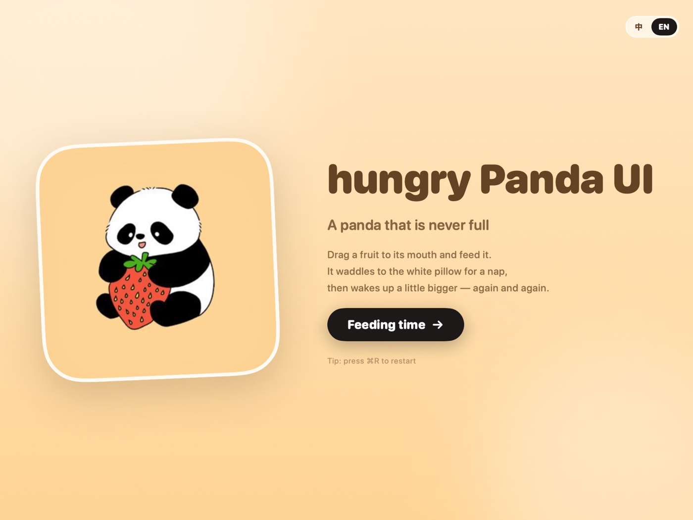
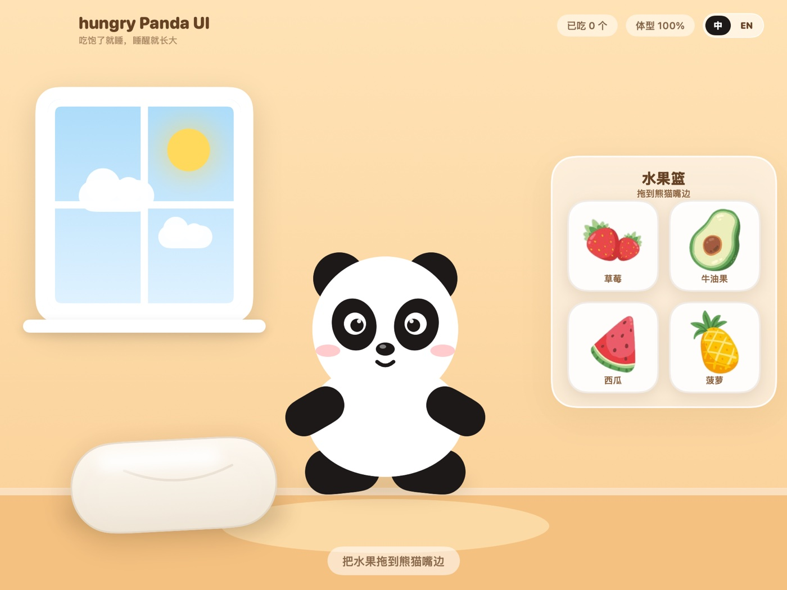
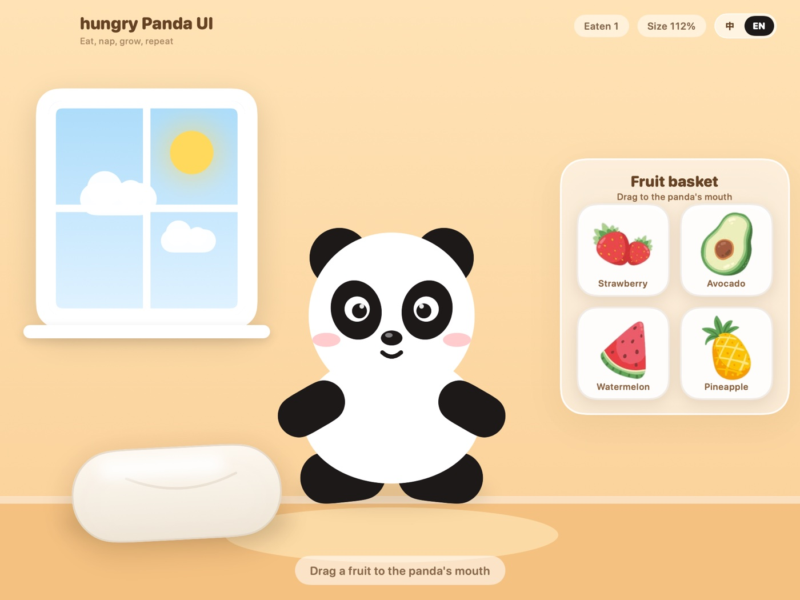
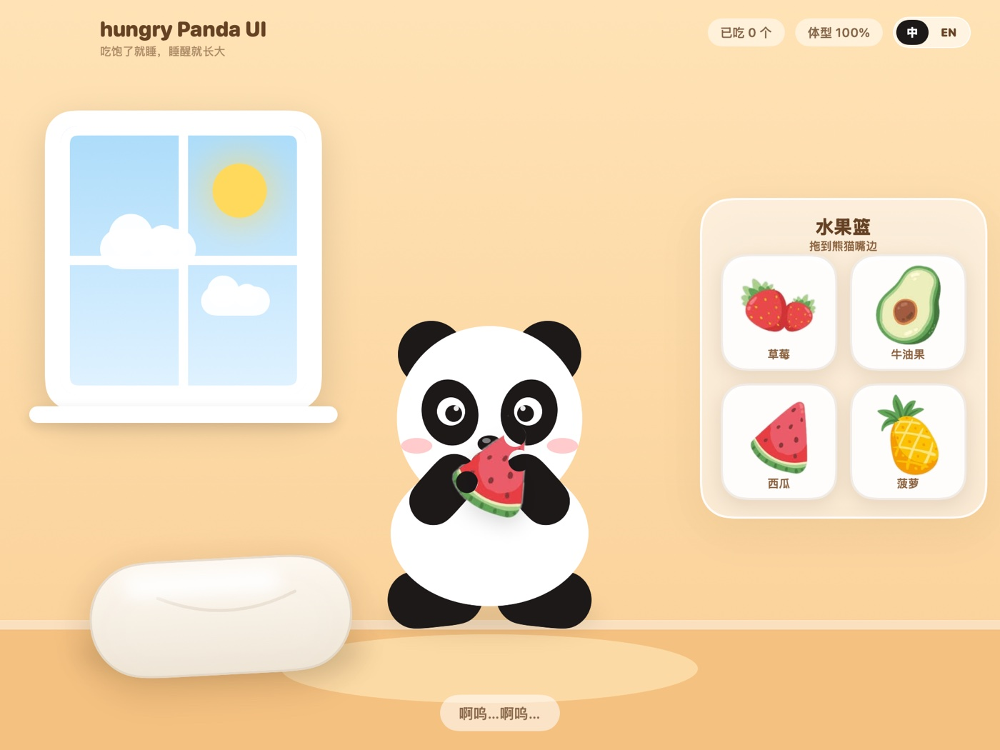
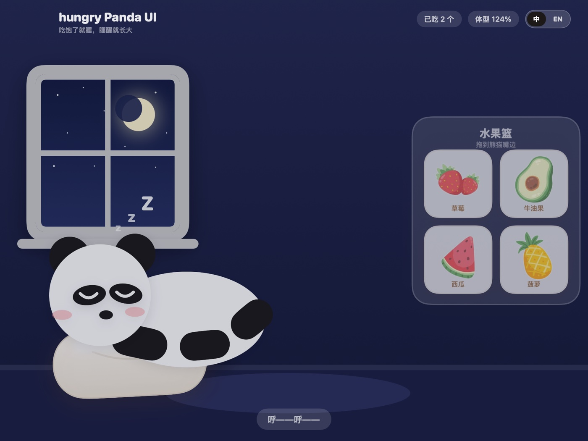

# hungry Panda UI 🐼🍓

A panda that is never full — a small macOS desktop app built with **SwiftUI**.

Drag a fruit to its mouth, watch it chew bite by bite, waddle over to the white pillow for a nap,
and quietly grow a little bigger overnight.

English · [中文](README.md)



## How to play

1. **Daytime** — the panda stands in the middle of the room; the fruit basket on the right holds a strawberry, an avocado, a watermelon and a pineapple.
2. **Feed it** — drag any fruit onto the panda's mouth and let go. It raises both paws and starts eating. Every bite leaves a half-circle bite mark on the fruit and plays that fruit's chewing sound.
3. **Finish** — it keeps chewing until the audio ends, the fruit disappears, and the panda walks to the white pillow on the left.
4. **Sleep** — it lies down, closes its eyes, the room turns to night and `xm4209.mp3` plays; while it sleeps, it slowly grows.
5. **Wake up** — it opens its eyes, the room fades back to daytime, the panda is one size bigger and the fruit basket refills. Feed it again and it grows again.

## Bilingual UI

Use the `中 / EN` switch in the top-right corner at any time. The choice is stored in `UserDefaults`, so it survives relaunches.

<p align="center">
  
  
</p>

## Run it

**Prebuilt**: double-click `HungryPanda.app` (a universal binary — Apple Silicon and Intel).

> If macOS says the developer cannot be verified, right-click the app → **Open**. The app is ad-hoc signed and not notarized.

**Build from source**:

```bash
cd HungryPanda
./build.sh          # requires Xcode Command Line Tools (swiftc)
open HungryPanda.app
```

`build.sh` compiles arm64 + x86_64, lipos them into a universal binary, copies resources and applies an ad-hoc signature.

Requires macOS 14 or newer.

## Screens

| Eating | Sleeping |
| --- | --- |
|  |  |

## Project layout

```
HungryPanda/
├── Sources/
│   ├── App.swift           app entry, window, menus
│   ├── RootView.swift      cover ↔ scene
│   ├── SceneView.swift     main scene, fruit basket, drag gestures, HUD
│   ├── PandaViews.swift    vector panda: standing / eating / sleeping / Zzz
│   ├── RoomViews.swift     room, windows (day & night), pillow
│   ├── CoverView.swift     cover screen
│   ├── GameModel.swift     state machine: chew → walk → sleep → grow → day
│   ├── Localization.swift  Chinese / English copy
│   ├── SoundPlayer.swift   AVAudioPlayer wrapper
│   ├── Theme.swift         palette and layout constants
│   └── Assets.swift        resource loading
├── Resources/
│   ├── fruits/             four cut-out fruits (generated from fruits.jpg)
│   ├── audio/              chewing and night sounds
│   ├── cover.jpg           cover art
│   ├── prepare_assets.py   cut-out + app icon generator
│   └── AppIcon.icns
├── Tools/
│   ├── RenderPreview.swift offscreen renders of every state
│   └── FlowTest.swift      end-to-end state machine run (muted)
├── Info.plist
└── build.sh
```

## Asset → sound mapping

| Fruit | Sound file |
| --- | --- |
| Strawberry | `asmr-almond-eating-single-close-mouth.mp3` |
| Avocado | `asmr-almond-eating-single-open-mouth.mp3` |
| Watermelon | `dog-eat-dry-close.mp3` |
| Pineapple | `asmr-aggressive-eating-chewy-cookie-single-open-mouth.mp3` |
| Night / growing | `xm4209.mp3` |

The fruit art comes from `Resources/fruits.jpg` (a 3×3 grid). `prepare_assets.py` crops each fruit with hand-measured boxes, flood-fills the light grey background away and feathers the edges to produce four transparent PNGs.

## Implementation notes

- **Fully vector panda** — body, eye patches, ears and paws are all SwiftUI shapes, so it stays crisp at any size.
- **Half-circle bite marks** — a circle is composited over the artwork with `blendMode(.destinationOut)` inside a `compositingGroup()`, punching a real notch out of the sprite.
- **Timing follows the audio** — the number of bites (2–9) is derived from the clip length, and the panda keeps chewing until the clip ends; `AVAudioPlayer.isPlaying` is polled before advancing.
- **Serial state machine** — `cover → idle → dragging → eating → walking → sleeping → waking → idle`; each phase accepts only its own input, so repeated drags cannot break the sequence.
- **Cumulative growth** — every fruit eaten adds `growth += 0.12` (capped at 1.80), anchored at the feet so the panda grows upward.

## Notes

- A personal practice project. Artwork and sound assets were provided by the author and are distributed with this project only.
- To swap fruits or sounds, replace `Resources/fruits/*.png` and `Resources/audio/*.mp3`, then run `./build.sh` again.
