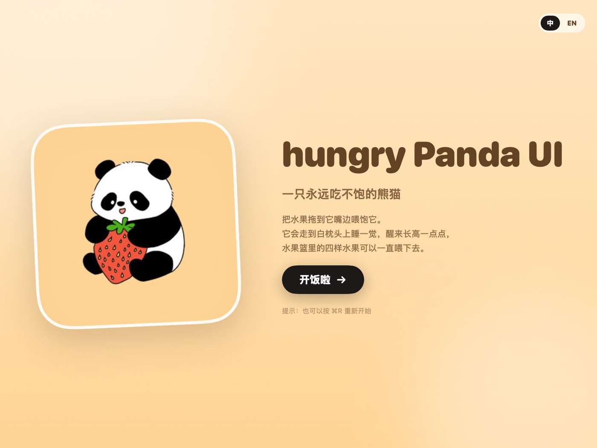

# hungry Panda UI 🐼🍓

一只永远吃不饱的熊猫 —— 一个用 **SwiftUI** 写的 macOS 桌面小应用。

把水果拖到它嘴边，看它一口一口吃完、走到白枕头上睡一觉，然后在夜里悄悄长大一点。

[English](README.en.md) · 中文



## 玩法

1. **白天**：熊猫站在房间中间，右侧水果篮里有草莓、牛油果、西瓜、菠萝。
2. **喂食**：把任意水果拖到熊猫嘴边松手，熊猫会举起双爪开始吃。每咬一口，水果上就多出一个半圆牙印，同时播放这只水果对应的咀嚼音效。
3. **吃饱**：一直嚼到音频播完，水果消失，熊猫挺着肚子走向左边的白枕头。
4. **入睡**：它躺到枕头上闭眼，画面切到夜晚，播放 `xm4209.mp3`；这段时间里它的体型会慢慢变大。
5. **醒来**：睁开眼、画面切回白天，熊猫比之前大一圈，水果篮自动补满——继续喂，它会继续长大。

## 中英双语

右上角的 `中 / EN` 可以随时切换界面语言，选择会保存在 `UserDefaults` 里，下次打开仍然生效。

<p align="center">
  
  
</p>

## 运行

**直接下载**：[Releases · hungry Panda UI 1.0](https://github.com/ruixi1800/hungry-panda-ui/releases/latest) → 下载 `HungryPanda-1.0-macOS.zip`，解压后双击 `HungryPanda.app`（通用二进制，Apple Silicon / Intel 都可以）。

> 首次打开如果提示“无法验证开发者”，右键点击 App → **打开** 即可。App 是 ad-hoc 签名，没有公证。

**从源码构建**：

```bash
cd HungryPanda
./build.sh          # 需要 Xcode Command Line Tools（swiftc）
open HungryPanda.app
```

`build.sh` 会编译 arm64 + x86_64、合成通用二进制、拷贝资源、做 ad-hoc 签名。

系统要求：macOS 14 或更高。

## 界面

| 吃东西 | 睡觉 |
| --- | --- |
|  |  |

## 项目结构

```
HungryPanda/
├── Sources/
│   ├── App.swift           应用入口、窗口、菜单
│   ├── RootView.swift      封面 ↔ 场景
│   ├── SceneView.swift     主场景、水果篮、拖拽手势、HUD
│   ├── PandaViews.swift    矢量熊猫：站立 / 进食 / 睡觉 / Zzz
│   ├── RoomViews.swift     房间、窗户（白天与夜晚）、枕头
│   ├── CoverView.swift     封面
│   ├── GameModel.swift     状态机：咀嚼 → 走路 → 入睡 → 长大 → 白天
│   ├── Localization.swift  中文 / English 文案
│   ├── SoundPlayer.swift   AVAudioPlayer 封装
│   ├── Theme.swift         配色与布局常量
│   └── Assets.swift        资源加载
├── Resources/
│   ├── fruits/             四种水果抠图（由 fruits.jpg 生成）
│   ├── audio/              咀嚼音效与夜晚音效
│   ├── cover.jpg           封面原图
│   ├── prepare_assets.py   水果抠图 + 图标生成脚本
│   └── AppIcon.icns
├── Tools/
│   ├── RenderPreview.swift 离线渲染各状态截图
│   └── FlowTest.swift      端到端跑一遍状态机（静音）
├── Info.plist
└── build.sh
```

## 素材与音效映射

| 水果 | 音效文件 |
| --- | --- |
| 草莓 | `asmr-almond-eating-single-close-mouth.mp3` |
| 牛油果 | `asmr-almond-eating-single-open-mouth.mp3` |
| 西瓜 | `dog-eat-dry-close.mp3` |
| 菠萝 | `asmr-aggressive-eating-chewy-cookie-single-open-mouth.mp3` |
| 夜晚 / 长大 | `xm4209.mp3` |

水果图来自 `Resources/fruits.jpg`（3×3 网格）：`prepare_assets.py` 按实测像素框裁切、泛洪抠掉浅灰背景、羽化边缘，输出四张透明 PNG。

## 实现要点

- **全矢量熊猫**：身体、眼罩、耳朵、爪子都是 SwiftUI 形状，随体型缩放也不会糊。
- **半圆牙印**：贴图上叠一层圆形，用 `blendMode(.destinationOut)` 在 `compositingGroup()` 里挖空，看起来就是被咬掉的缺口。
- **节奏跟音频走**：按音频时长决定咬几口（2–9 口），音频没播完就一直嚼；`AVAudioPlayer.isPlaying` 轮询到结束才进入下一阶段。
- **状态机串行**：`cover → idle → dragging → eating → walking → sleeping → waking → idle`，每个阶段只接受对应的输入，避免连点拖拽把流程打乱。
- **体型累计**：每吃一个水果 `growth += 0.12`，上限 1.80，脚底锚定不动，所以是“往上长”。

## 备注

- 这是一个个人练习作品，美术与音效素材由作者提供，仅随本项目一起分发。
- 想改成别的水果 / 别的音效，替换 `Resources/fruits/*.png` 和 `Resources/audio/*.mp3` 后重新 `./build.sh` 即可。
